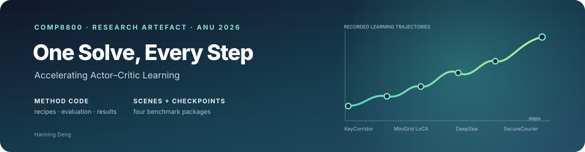
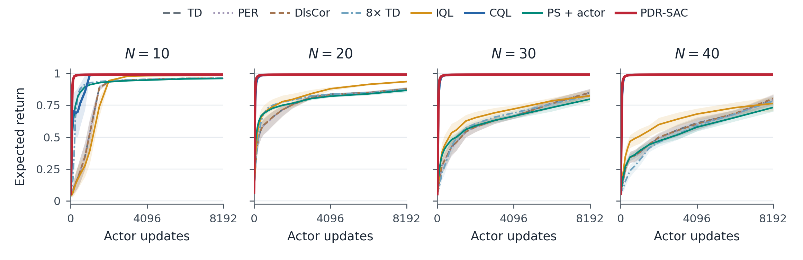
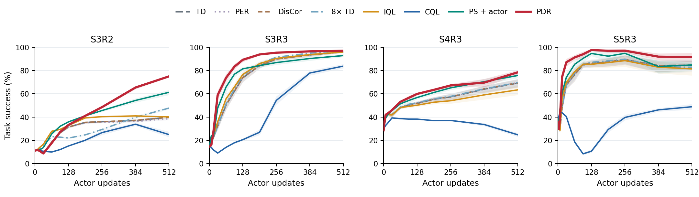
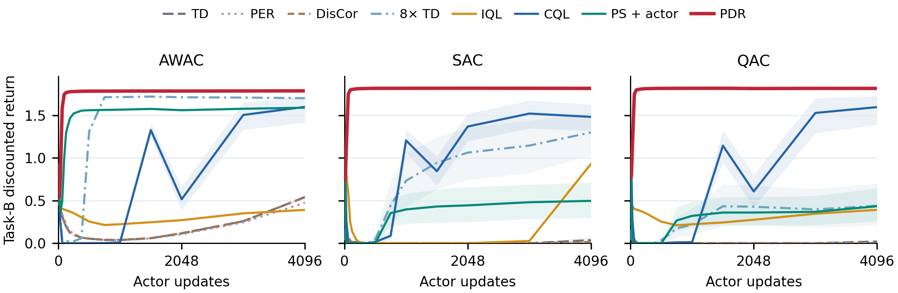

<div align="center">



### A reproducible research artefact for COMP8800 · Australian National University

**One Solve, Every Step: Accelerating Actor–Critic Learning**  
Hanning Deng · 2026

[](https://huggingface.co/datasets/denghanning/COMP8800_Research_Project)
[](#the-four-benchmarks)
[](#simulator-scenes--inputs)
[](https://huggingface.co/datasets/denghanning/COMP8800_Research_Project)

</div>

> **Start here:** this repository contains the method code, exact experiment recipes, evaluation tools and result summaries. The companion dataset contains the benchmark simulator inputs, recorded outcomes and saved checkpoints. Both repositories are public and ready to browse.

| Need | Go to |
|---|---|
| Browse code, configs and evaluation commands | [Repository contents](#repository-map) |
| Download benchmark scenes, inputs and checkpoints | [Hugging Face dataset](https://huggingface.co/datasets/denghanning/COMP8800_Research_Project) |
| Restore one benchmark from the archive | [Download and restore](#download-and-restore-a-benchmark) |
| Re-evaluate saved actors | [Evaluation commands](#evaluate-saved-checkpoints) |
| Understand exactly what is included | [Scope and validation](#scope--validation) |

## At a glance

| 4 benchmark suites | 71,343 archived paths | 57,191 unique payloads | 28.75 GB compressed |
|:---:|:---:|:---:|:---:|
| KeyCorridor · MiniGridLoCA · DeepSea · SecureCourier | Full selected release trees | SHA-256 deduplicated | 256 verified shards |

The archive preserves the simulator inputs and scene-specific data used by these benchmark packages, together with the saved starts, retained checkpoints, reference data, raw results, run configurations and native scripts. It contains the original benchmark files in a content-addressed archive; restore them to ordinary directories before running the native simulators.

## The four benchmarks

<table>
<tr><th>Benchmark</th><th>Simulator scenes / conditions</th><th>Recorded comparison</th><th>Archive</th></tr>
<tr><td><b><a href="src/releases/KeyCorridor/README.md">KeyCorridor</a></b></td><td><code>S3R2</code>, <code>S3R3</code>, <code>S4R3</code>, <code>S5R3</code></td><td>640 runs · 8 methods · 20 seeds per setting</td><td>6.56 GB</td></tr>
<tr><td><b><a href="src/releases/MiniGridLoCA/README.md">MiniGridLoCA</a></b></td><td>MiniGrid LoCA task and its packaged task/branch inputs; AWAC, SAC and QAC actor backbones</td><td>480 runs · 8 methods · 20 paired seeds</td><td>8.05 GB</td></tr>
<tr><td><b><a href="src/releases/DeepSea/README.md">DeepSea</a></b></td><td>Parameterized DeepSea worlds at <code>N=10, 20, 30, 40</code>; world graphs, schedules and support/history inputs are included</td><td>520 runs · 8 methods · eligible cohorts 20/19/13/13</td><td>3.51 GB</td></tr>
<tr><td><b><a href="src/releases/SecureCourier/README.md">SecureCourier</a></b></td><td>50 paired confirmatory events; both Standard TD and PDR trajectories through cycle 2,048</td><td>100 arm runs · retained score and checkpoint grids</td><td>10.63 GB</td></tr>
</table>

### Simulator scenes & inputs

Scene-specific simulator material is included in the checkpoint dataset, not merely linked as an external dependency. This includes the four named KeyCorridor task layouts; MiniGridLoCA task, branch and provenance inputs; each DeepSea world graph and schedule; and SecureCourier's paired event data and saved state grids. Native environment definitions and supporting scripts are included in each restored release where present.

After restore, the scene inputs are under `AAMAS-Experiment/Effectiveness/<Benchmark>/inputs/` (for example, KeyCorridor's `inputs/key/S3R2/domain/graph.npz` and DeepSea's `inputs/deepsea/worlds/N10/seed_*/graph.npz`). SecureCourier event-specific states are under `AAMAS-Experiment/Effectiveness/SecureCourier/checkpoints/confirmatory_*/`. The archive contains all the paths from these four selected benchmark release trees.

The archive also includes the original benchmark READMEs and their environment/build notes. See [`docs/experiment_index.md`](docs/experiment_index.md) and the per-benchmark READMEs under [`src/releases/`](src/releases/) for details. Check the dataset card's **Contents** section for exact restore commands and archive paths.

<div align="center">


</div>
<div align="center">

</div>

## Quick start

### 1 · Install the evaluation environment

Python 3.10 is used by the release. CPU is sufficient for saved-checkpoint evaluation. Original training used PyTorch 2.5.1+cu121; continuing training may require CUDA and benchmark-specific native builds.

```bash
python3.10 -m venv .venv
source .venv/bin/activate
python -m pip install -r requirements.txt
python -m pip install -r requirements-publish.txt
```

See `src/releases/<benchmark>/README.md` for each simulator's additional build instructions.

### 2 · Download and restore a benchmark

The dataset is public. Download the pinned dataset revision (Hugging Face authentication is optional for public access):

```bash
python scripts/download_checkpoints.py --out checkpoints/local
python scripts/checkpoint_archive.py list --archive-root checkpoints/local --release DeepSea
python scripts/checkpoint_archive.py verify --archive-root checkpoints/local --release DeepSea
python scripts/checkpoint_archive.py restore --archive-root checkpoints/local --release DeepSea --output work/DeepSea
```

Replace `DeepSea` with `KeyCorridor`, `MiniGridLoCA` or `SecureCourier` to restore the other simulator package. Restore writes into a new output directory and verifies each payload as it is read.

### 3 · Evaluate saved checkpoints

```bash
bash scripts/evaluate.sh --benchmark DeepSea --archive checkpoints/local
bash scripts/evaluate.sh --benchmark MiniGridLoCA --archive checkpoints/local
bash scripts/evaluate.sh --benchmark KeyCorridor --archive checkpoints/local
bash scripts/evaluate.sh --benchmark SecureCourier --archive checkpoints/local
```

These commands evaluate retained actors against the recorded benchmark data; they do not retrain the models. For a quick KeyCorridor smoke check, add `--representative`. Evaluation coverage and tolerances are recorded in `evaluation/results/`.

### 4 · Rebuild results or continue training

```bash
python scripts/run.py results --benchmark DeepSea --archive checkpoints/local
CUDA_VISIBLE_DEVICES=0 bash scripts/reproduce.sh --benchmark DeepSea \
  --archive checkpoints/local -- --size 10 --method PDR --updates 8192
```

Result reconstruction uses archived raw outcomes. Training commands continue from supplied saved starts and use the recorded recipe; they do not claim to repeat any from-scratch pretraining. Each run writes to a new workspace.

## Scope & validation

This release focuses on the four benchmark packages above. It does not include every analysis or ablation checkpoint history from the report, and it does not claim that every reported training run was freshly repeated. Fresh checks covered all 520 DeepSea actors and all 480 MiniGridLoCA actors, 32 KeyCorridor representatives across all four tasks and eight methods, and archive-byte integrity for all 57,191 unique payloads. The remote Hugging Face shards were also checked against their SHA-256 manifest. SecureCourier's fresh scorer check covered a documented subset of events/cycles. Detailed evidence and coverage limits are in [`evaluation/results/`](evaluation/results/) and [`docs/reproducibility.md`](docs/reproducibility.md).

## Repository map

```text
README.md                         This overview and quick start
assets/artifact-banner.svg        Project cover graphic
configs/                          Pinned release and experiment recipes
src/releases/                     Four benchmark implementations and native notes
scripts/                          Download, restore, evaluate and reproduce commands
evaluation/results/               Figures, summaries and scoped validation evidence
checkpoints/README.md             Dataset access and archive pointers
docs/                             Method map, experiment index and handover notes
```

## Citation & access

**Project:** *One Solve, Every Step: Accelerating Actor–Critic Learning* · Hanning Deng · Australian National University · 2026.

- Code and experiment recipes: [GitHub repository](https://github.com/Hanning99/COMP8800_Research_Project)
- Simulator inputs, recorded results and saved checkpoints: [Hugging Face dataset](https://huggingface.co/datasets/denghanning/COMP8800_Research_Project)
- Artefact handover notes: [`docs/submission.md`](docs/submission.md)

Both links point to public repositories. The scope and validation statements on this page describe the released artefact and should be read alongside the original benchmark notices and report.
