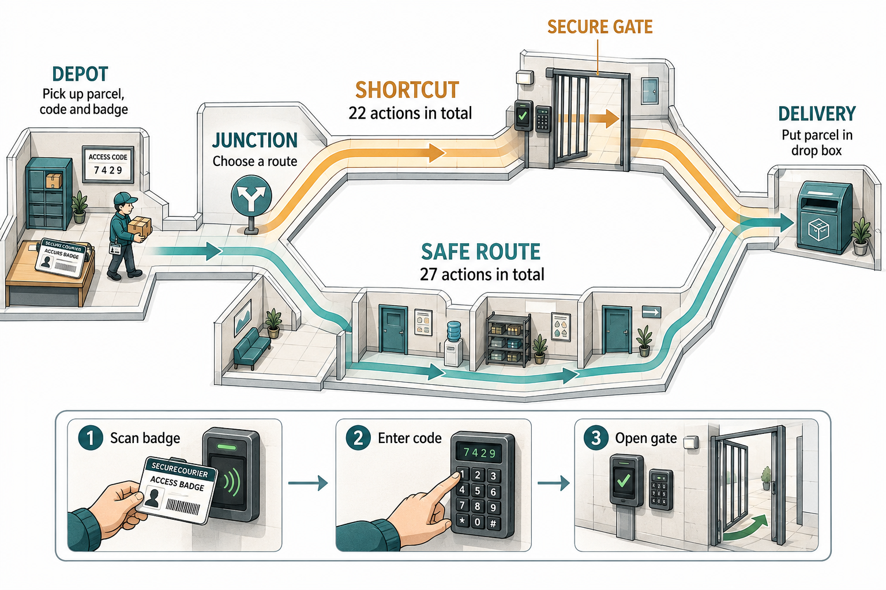
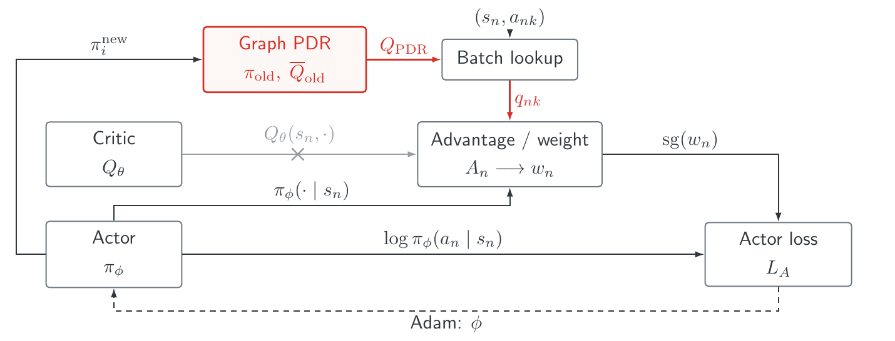
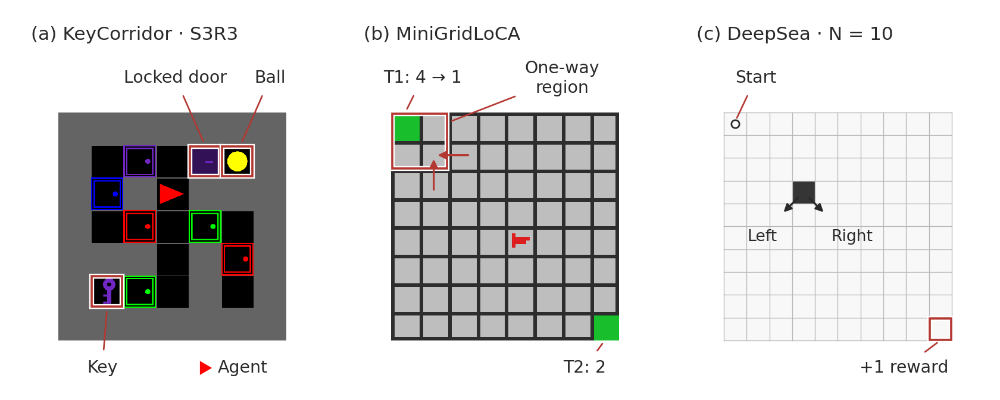
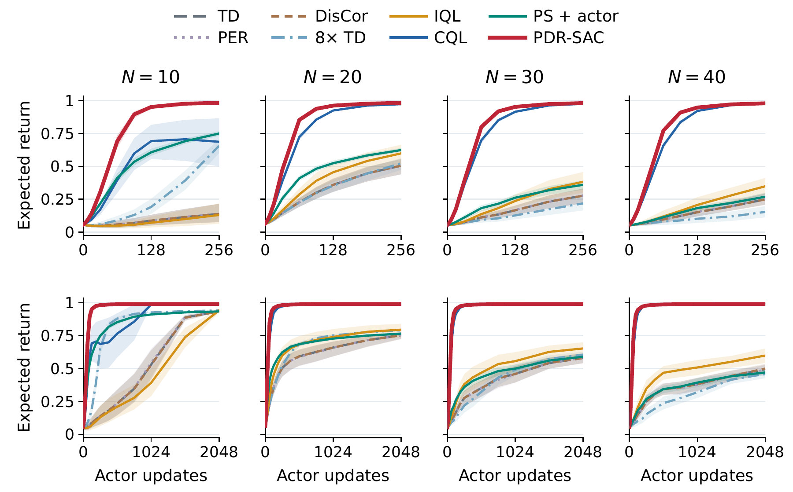
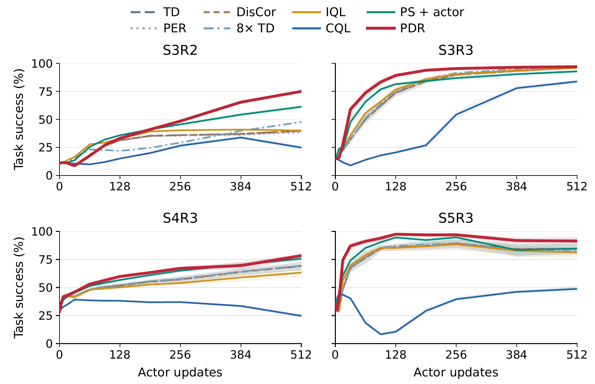
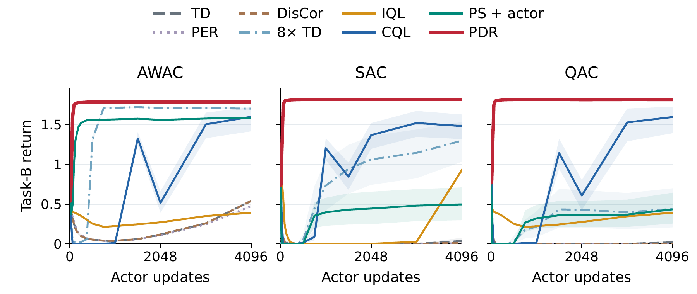
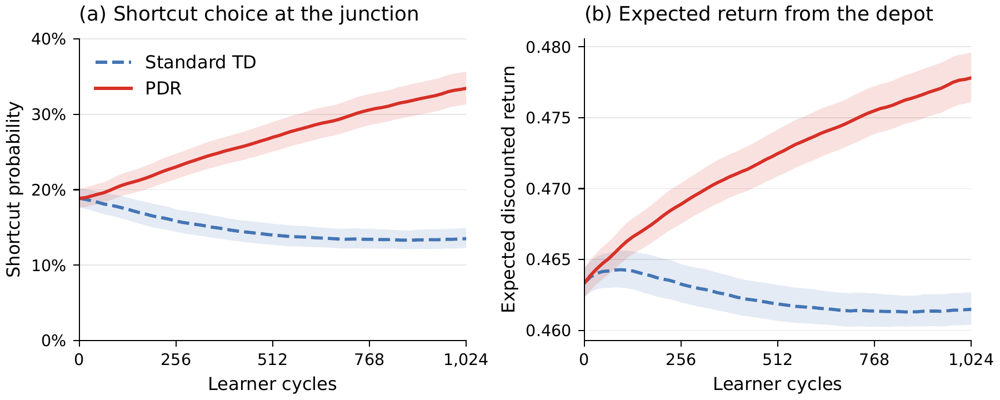
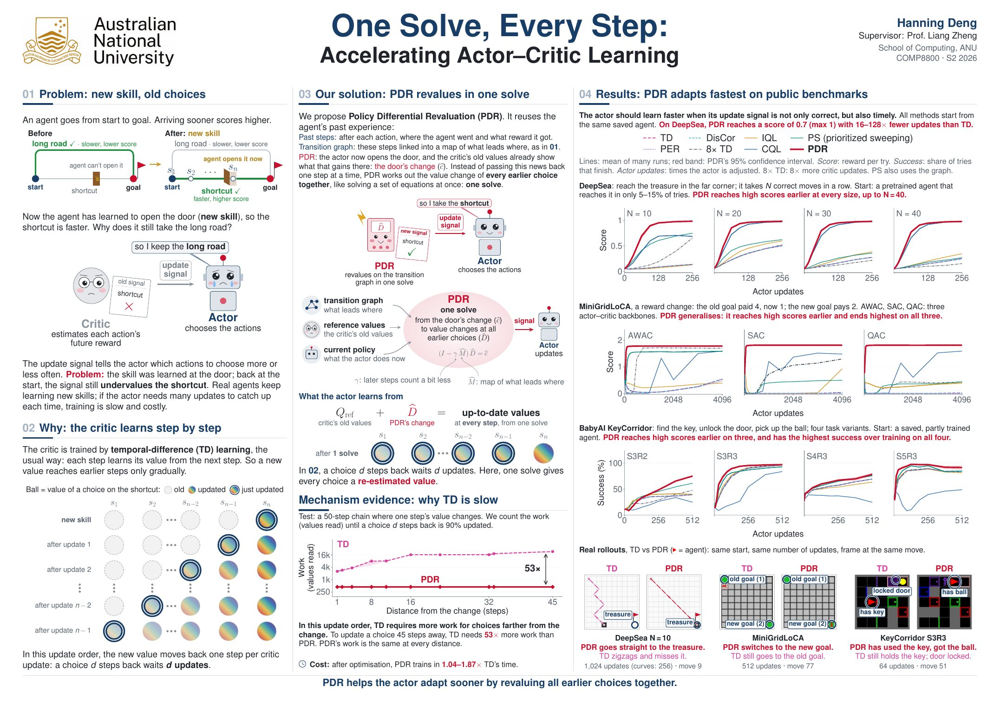

<div align="center">

<sub>AUSTRALIAN NATIONAL UNIVERSITY · COMP8800 · 2026</sub>

# One Solve, Every Step

### Accelerating Actor–Critic Learning

**Hanning Deng** · Supervisor: Prof. Liang Zheng

*Helping the actor use a newly learned skill sooner.*

<a href="docs/report.pdf"><b>Read the report</b></a> &nbsp; / &nbsp; <a href="docs/poster/poster-A1.pdf"><b>A1 poster</b></a> &nbsp; / &nbsp; <a href="https://huggingface.co/datasets/denghanning/COMP8800_Research_Project"><b>Checkpoints & data</b></a> &nbsp; / &nbsp; <a href="#quick-start"><b>Reproduce</b></a>

</div>

---



<p align="center"><sub>SecureCourier, from the report: learning to open the gate creates a shorter route. How quickly does the actor start choosing it?</sub></p>

## The idea

**Policy Differential Revaluation (PDR)** uses the current policy, a fixed reference and a transition graph to recompute the value signal used by the actor. The critic continues its usual learning; PDR supplies the actor with a revalued signal at each update.




<p align="center"><sub>Original report figure: one AWAC actor update with PDR. See the report for the SAC and QAC variants.</sub></p>

## Explore the benchmarks



| Benchmark | Scenes & settings | Retained experiments | Compressed content |
|:--|:--|:--|--:|
| **KeyCorridor** | S3R2 · S3R3 · S4R3 · S5R3 | 640 runs · 8 methods · 20 seeds per setting | 6.56 GB |
| **MiniGridLoCA** | Reward-change task · AWAC, SAC & QAC | 480 runs · 8 methods · 20 paired seeds | 8.05 GB |
| **DeepSea** | N = 10 · 20 · 30 · 40 | 520 runs · 8 methods · 20/19/13/13 eligible seeds | 3.51 GB |
| **SecureCourier** | Gate skill & route choice | 50 paired events · TD & PDR · retained states through cycle 2,048 | 10.63 GB |


Scene inputs, simulator implementations and retained checkpoints are included in the four release packages. [Browse the dataset →](https://huggingface.co/datasets/denghanning/COMP8800_Research_Project)

## Results from the report

### DeepSea · learning after the saved start



PDR-SAC uses an exact soft reference. The figure shows the first 256 updates above and the 2,048-update early window below. Full-horizon results and comparisons are in the report.

<details>
<summary><b>KeyCorridor · view the report figure</b></summary>



Success probability over 512 actor updates; eight methods and 20 paired seeds per task. PDR has the highest early mean on three of four tasks; S3R2 improves later.

</details>

<details>
<summary><b>MiniGridLoCA · view the report figure</b></summary>



Task-B discounted return over 4,096 updates from AWAC, SAC and QAC starts; eight methods and 20 paired seeds per branch.

</details>

<details>
<summary><b>SecureCourier · view the report figure</b></summary>



Shortcut choice and discounted return over cycles 0–1,024; means over 50 paired seeds. This is an early-learning comparison; the later non-inferiority test at cycle 2,048 did not pass.

</details>

## Quick start

Use **Python 3.10**. Saved-checkpoint evaluation can run on CPU. Downloading the full pinned archive requires approximately 28.75 GB, plus space for restored files.

```bash
git clone https://github.com/Hanning99/COMP8800_Research_Project.git
cd COMP8800_Research_Project
python3.10 -m venv .venv
source .venv/bin/activate
python -m pip install -r requirements.txt -r requirements-publish.txt
python scripts/download_checkpoints.py --out checkpoints/local
bash scripts/evaluate.sh --benchmark DeepSea --archive checkpoints/local
```

Use `KeyCorridor`, `MiniGridLoCA` or `SecureCourier` for the other packages. Add `--representative` to KeyCorridor for a smaller evaluation. Each command writes to a new workspace.

| I want to… | Start here |
|:--|:--|
| Understand the method | [Report](docs/report.pdf) · [Implementation map](docs/method_map.md) |
| Inspect the simulator code | [Four native releases](src/releases/) |
| Find a run recipe | [Recorded configurations](configs/) |
| Evaluate a saved model | [Reproducibility guide](docs/reproducibility.md) |
| Inspect results and checks | [Evaluation evidence](evaluation/results/) |
| Download original data | [Hugging Face](https://huggingface.co/datasets/denghanning/COMP8800_Research_Project) · [Archive guide](checkpoints/README.md) |

<details>
<summary><b>Restore simulator inputs, rebuild results or continue training</b></summary>

```bash
# Restore one complete benchmark package, including its scene inputs.
python scripts/checkpoint_archive.py restore --archive-root checkpoints/local \
  --release DeepSea --output work/DeepSea

# Reconstruct results from recorded outcomes.
python scripts/run.py results --benchmark DeepSea --archive checkpoints/local

# Continue training from the supplied start; CUDA/native builds may be required.
CUDA_VISIBLE_DEVICES=0 bash scripts/reproduce.sh --benchmark DeepSea \
  --archive checkpoints/local -- --size 10 --method PDR --updates 8192
```

Restored files live under `AAMAS-Experiment/Effectiveness/<Benchmark>/`. KeyCorridor task graphs are in `inputs/key/<task>/domain/graph.npz`; DeepSea worlds are in `inputs/deepsea/worlds/N*/seed_*/`. MiniGridLoCA includes branch and task inputs. SecureCourier includes event-specific states under `checkpoints/confirmatory_*/`.

Training reproduction continues from supplied checkpoints. Read the native release README for dependencies and method-specific flags.

</details>

## A verifiable research artefact

| Four benchmark packages | 71,343 retained file paths | 28.75 GB compressed |
|:--:|:--:|:--:|
| Simulators & experiment recipes | Raw outcomes & saved states | 256 SHA-256 verified shards |


The release covers **these four benchmark packages**, including simulator inputs, raw results and the checkpoints retained by each package. Additional report analyses and ablation checkpoint histories are outside this archive.

<details>
<summary><b>What was verified?</b></summary>

- All 57,191 unique archived payloads: decompressed size and SHA-256 checked.
- All 256 remote checkpoint shards: matched against the release manifest.
- Fresh actor evaluation: all 520 DeepSea actors, all 480 MiniGridLoCA actors, 32 KeyCorridor representatives and a documented SecureCourier subset.
- 10,560 input/path/hash checks across the 1,640 KeyCorridor, MiniGridLoCA and DeepSea run records.

Integrity checking, checkpoint evaluation and training reproduction have different scopes. Exact coverage and tolerances are recorded in [evaluation/results](evaluation/results/). No claim is made that every training run was freshly repeated.

</details>

## The project at a glance

<a href="docs/poster/poster-A1.pdf"></a>

[Open the A1 poster](docs/poster/poster-A1.pdf) · [Read the report](docs/report.pdf) · [Submission guide](docs/submission.md)

---

<sub>Hanning Deng · Australian National University · 2026. Figures are taken from the project report and poster; original figure provenance is recorded in <a href="assets/report/SOURCES.json">SOURCES.json</a>. Both repositories are public.</sub>
